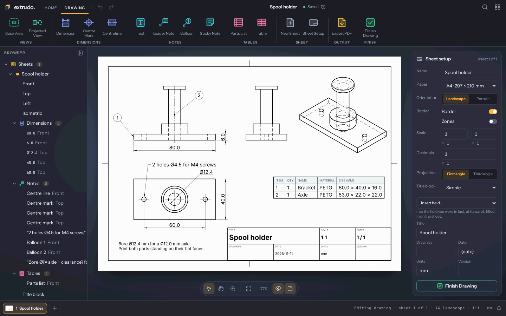
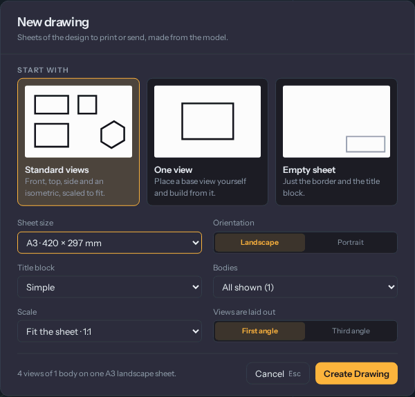
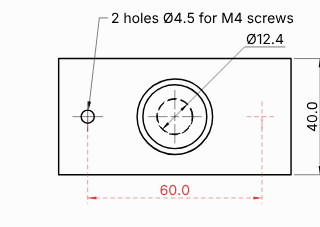
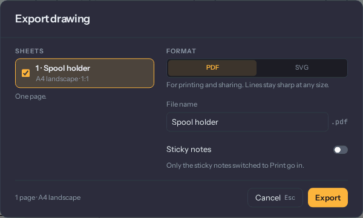

# Drawings

A **drawing** is a set of flat sheets made from your model: views of the part from the front,
the top and the side, with dimensions, notes and a parts list, ready to print or to send to
someone who makes it. Each page is a **sheet**.

A drawing follows the model. The views are worked out from the bodies each time a sheet is
shown, and so are the dimensions and the parts list: change a parameter and the lines, the
numbers and the sizes change with it. Nothing on a sheet can push the model around. To change
the part, change the model.

The [Spool holder](./examples.md) example has a finished sheet to look at and take apart.

## Making a drawing

Choose **Drawing** in the Make tab. In a design without sheets it opens **New drawing**; in one
that has sheets it opens the one you worked on last. The browser's **Drawings** folder lists
the sheets too: double-click one to open it. In the command palette (`Ctrl+K`) they are
"New Drawing", "Open Drawing" and "Sheet: name".

New drawing starts the sheet one of three ways:

- **Standard views**: the front, the top, a side and an isometric, lined up and at the largest
  standard scale that fits above the title block. Most drawings start here.
- **One view**: a sheet at the scale that fits the front view, then [Base View](./tools/baseView.md)
  so you place it yourself.
- **Empty sheet**: only the border and the title block.

Below the cards you choose the paper, landscape or portrait, the title block, which bodies the
views show, the scale and whether views are laid out **first angle** (the view from the left is
placed on the right) or **third angle** (it is placed on the left). Create Drawing makes it all
in one step, so one undo takes it back.

The drawing replaces the 3D view while it is open. The toolbar has Home and **Drawing**, the
sheet tabs take the timeline's place, and the browser shows the Sheets tree: each sheet with
its views, dimensions, notes, tables and title block. Pan and zoom the way you do in the 3D
view, and `F6` fits the sheet. **Finish Drawing** goes back to the model. You don't save
anything on the way out: every change is already in the design. Esc never leaves the drawing.
It ends a tool, then clears the selection.

**Parameters** stays available in the drawing. Change a value there and watch the views follow.

## Views

A **base view** looks at the model from a direction you choose: [Base View](./tools/baseView.md)
(`V`) shows its choices on the right (Looking from, Scale, Style), and a frame with the view's
lines follows the pointer until you click to place it. Then the tool carries on as Projected
View from the view you placed.

A **projected view** is lined up with another view: [Projected View](./tools/projectedView.md)
(`P`) takes the selected view, and where you move the pointer decides which side you get.
Beside, above or below gives that side's view for the sheet's projection angle, and a diagonal
gives an isometric. The panel names what a click makes. A projected view keeps its parent's
scale and style and stays lined up with it: dragging it moves it only along that line, unless
you hold **Alt**.

You can also drag a body from the browser onto the sheet for a front view of that body alone.

Click a view to change it in the card on the right: what it looks from, its scale (the sheet's,
a standard one, or your own), **Visible edges** or **Visible and hidden** (hidden edges dashed),
whether tangent edges, centre lines and its label show, and which bodies it draws. Right-click a
view for **Fit Scale** and **Projected View from This**.

Views are drawn one at a time. While a view is being worked out it shows its last lines faded,
or "Drawing the view…" the first time. After a moment a notice at the top of the sheet counts
the views, with **Cancel** to stop before the next one. Moving a view or changing its scale
computes nothing.

Views show the model at the timeline marker. Roll the marker back and the status bar says so:
"Showing the model at feature 5 of 7".

Section views and detail views are not there yet.

## Dimensions

[Dimension](./tools/sheetDimension.md) (`D`) is one tool for every kind. Hover over a view to see
what a click takes, then click: a line alone is its length, a circle its diameter, an arc its
radius. A second pick in the same view makes a distance between two lines or points, or the
angle between two lines. The dimension then follows the pointer with its value, and where you
put it decides horizontal, vertical or aligned. It stays on for the next one until Esc.

Only a view's final lines can be picked: while a view still shows its quick first lines, the
panel says it is being drawn.

A dimension **measures and never drives**. Its number comes from the model each time the sheet
is drawn, so it is always right for the model as it is. There is no number to type into it. To
change a size, change the feature or the parameter.

Select a dimension to set its decimals, a text before or after the value, its direction, or
brackets for a reference dimension.

### When a dimension loses its edge

If the edge a dimension measured is gone, because you deleted or suppressed the feature that
made it or that feature has an error, the dimension stays where it was, drawn in **red with
dashed lines**. The browser shows its row in red, and the status bar says why when you select
it: "Pocket, the feature this was measured on, is suppressed. Unsuppress it to show the
dimension again."

Undo, or turning the feature back on, brings it back. To measure something else instead,
select the lost dimension and **drag one of its end handles onto an edge**: that picks it again.
A dimension that was found again in a slightly different place is drawn as usual, with a
warning triangle and "moved" in its browser row.

An export never writes an old value: a lost dimension goes out as its text with "?" for the
number, and the export dialog counts them.

## Notes, centre marks and centre lines

- [Text](./tools/sheetText.md) (`T`): click on the paper and type. **Enter** finishes,
  **Shift+Enter** starts a new line, **Esc** leaves without making it. Double-click a text to
  type it again.
- [Leader Note](./tools/sheetLeader.md) (`N`): pick an edge, a point or a face, click where the
  text goes, and type. On a face the leader ends in a dot instead of an arrow. The note moves
  with the geometry it points at, and is picked again like a dimension when it loses it.
- [Centre Mark](./tools/sheetCentreMark.md): click a circle, such as a hole's rim, or a cylinder
  seen from the side. A cross goes on its centre.
- [Centreline](./tools/sheetCentreLine.md): click a cylinder's outline for a dash-dot line along
  its axis, or two parallel edges for one midway between them.

Centre marks and lines are never added by themselves: you place the ones you want. A view's
**Centre lines** switch hides them for that view.

## Sticky notes

A [Sticky Note](./tools/sheetSticky.md) is a coloured note to yourself or to whoever opens the
design next. It is **on screen only**: it says so in its corner, and exports leave it out. Turn
on its **Print** switch to put it on paper. The floating bar's **Show sticky notes** button
hides them all while you look at the sheet, and the export dialog has a switch to print every
note once without changing them.

## Parts lists, balloons and tables

A [Parts List](./tools/sheetPartsList.md) lists the bodies of a view: click the view, then
where the list goes. Equal bodies, with the same volume, the same size and the same name or
component, share one row with a quantity. The columns are Item, Qty, Name, Material, Size and
Mass. Mass uses the density of the material chosen in Print Info. Select the list to hide a
column or to type a name or a material over a row. The rest is worked out from the model each
time, so a new body gets its row by itself.

A [Balloon](./tools/sheetBalloon.md) (`B`) points at a part and shows its number in the parts
list: pick the part in a view that has a list, then click where the balloon goes. Deleting a
parts list deletes its balloons too.

A [Table](./tools/sheetTable.md) is a free table, for a revision list or anything else: click
where it goes, then double-click a cell to type in it. Its card adds and removes rows and
columns.

## Text fields

A text, a leader note, a table cell and the title block's fields can hold **fields in braces**,
filled in each time the sheet is drawn:

| Field | Becomes |
|---|---|
| `{name}` | the design's name |
| `{sheet}`, `{sheets}` | this sheet's number, and how many there are |
| `{scale}` | the sheet's scale |
| `{date}` | today's date |
| `{version}` | the newest saved [version](./files.md), such as V3 |
| `{= expression}` | a parameter expression with its unit, such as `{= axle + clearance}` |

The cards' **Insert field** menu writes one for you, with your parameters listed after the
fields. Renaming a parameter renames it inside `{= …}` too. A field that has no value yet is
left as you typed it.

## Sheets and the title block

A design can have as many sheets as you like. [New Sheet](./tools/newSheet.md) adds one after
the open sheet. The sheet tabs at the bottom switch between them: double-click a tab to rename
it, drag it to change the order, and use its menu to duplicate, export or delete it.
`Ctrl+PageUp` and `Ctrl+PageDown` step through them.

With nothing selected, the right column is [Sheet Setup](./tools/sheetSetup.md): the sheet's
name, its paper (a standard size or your own), landscape or portrait, the border, the scale the
views use unless they have their own, the decimals dimensions show, the projection angle, and
the title block. The **Simple** title block has a title, drawn by, date, units and version; the
**Full** one adds checked by, approved by, company, material and part number. The scale, the
sheet number and the projection fill themselves in.

"Drawn by" is never filled in for you. Once you have typed a name there, the last one is
offered back as a **Use …** button.

Paper is white in both the light and the dark theme: the sheet looks the way it will print.

## Exporting

[Export PDF](./tools/exportSheets.md) (`Ctrl+E`) opens **Export drawing**. Choose the sheets,
then **PDF** (one file, a page per sheet, at the true paper size) or **SVG** (a file per sheet),
and the file name. The text in a PDF can be selected and searched.

Before it writes anything, the export draws every view of the chosen sheets exactly and
measures the dimensions and parts lists again, so the file shows the model as it is now. Lines
are black, and lengths are in the design's unit.

Outside the app, the command-line tool writes the same files from a saved design:
`extrudo export bracket.extrudo --format pdf` writes every sheet into one PDF, `--format svg`
one SVG per sheet, and `extrudo check --sheets` fails when something on a sheet has lost its
geometry. The
[CLI guide](https://github.com/zoltanf/extrudo/blob/main/docs/cli.md) has the options.
