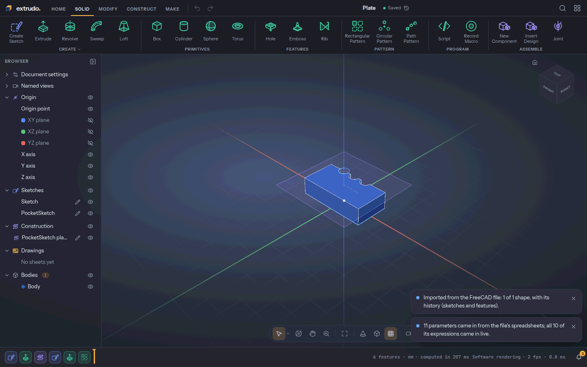
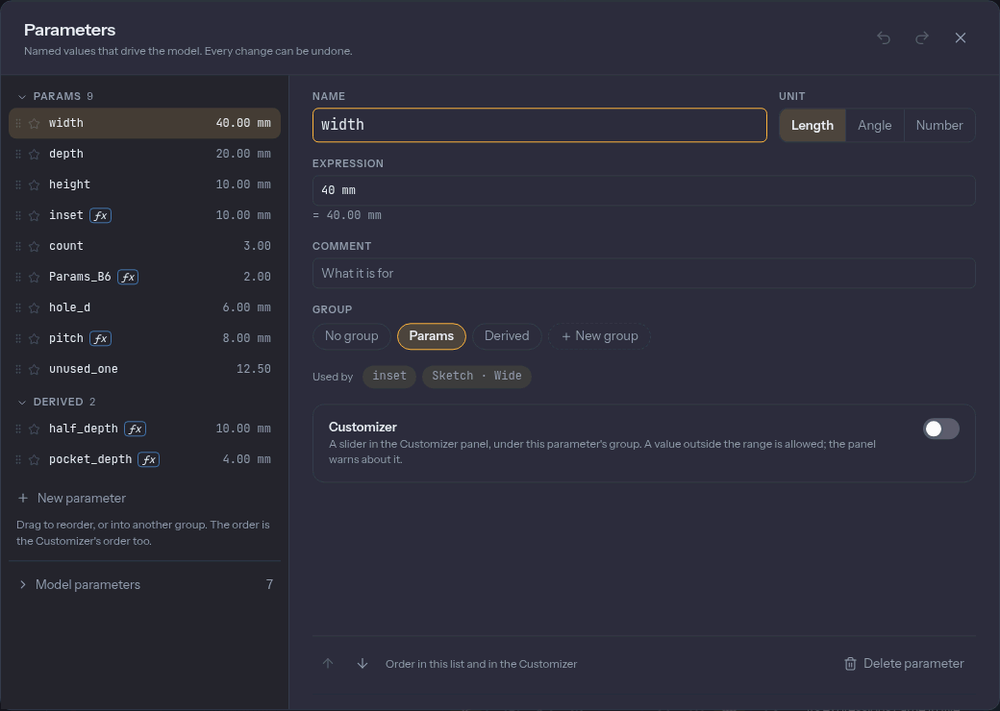

# FreeCAD files

Got designs in FreeCAD? Open the `.FCStd` file in Extrudo and carry on from there. Bodies come
in with their timeline where Extrudo can rebuild them, with your sketches, dimensions and
spreadsheet values, and as the file's own shape where it can't. This page says what comes in,
how Extrudo checks it, and what the notices after an import mean.

## Opening a FreeCAD file

There are three ways in, in the browser and in the desktop app alike:

- the home screen's **Import…** card,
- **Home › Import** in the ribbon,
- **Import Model** in an open design.

Each one opens the FreeCAD file as a **new design**, named after the file. Import Model doesn't
add the file's shapes to the design you have open; it makes a new one, as it does for an `.f3d`
file.

The file is read on your own machine, in the app itself. Nothing is uploaded. Your `.FCStd`
file isn't changed either: Extrudo only reads it, and the new design is saved in Extrudo's own
storage like any other.

While the import runs, a notice says "Importing the FreeCAD file's shapes…". The work happens in
the background, so the app stays usable. A large file can take a minute or more.

## What comes in

### Bodies, with their timeline

Each PartDesign body comes in as an Extrudo body with a timeline: its sketches and its features,
in FreeCAD's order, as Extrudo features you can open and edit.

| In FreeCAD | In Extrudo |
|---|---|
| Pad, Pocket | [Extrude](./tools/extrude.md), joining or cutting: a length, two lengths, through all, up to a face or a datum plane |
| Revolution, Groove | [Revolve](./tools/revolve.md), joining or cutting, about a sketch axis, an origin axis, a datum line or an edge |
| Fillet, Chamfer | [Fillet](./tools/fillet.md) and [Chamfer](./tools/chamfer.md), on the same edges |
| LinearPattern, PolarPattern | [Rectangular Pattern](./tools/rectangularPattern.md) and [Circular Pattern](./tools/circularPattern.md) |
| Mirrored | [Mirror](./tools/mirror.md) |
| MultiTransform | its patterns and mirrors one after another |
| Hole | [Hole](./tools/hole.md): simple, counterbored and countersunk; a threaded hole comes in as a plain hole of its stored size |
| Datum planes and lines | construction planes and axes where the file has them |
| PartDesign features outside a body (files from before FreeCAD 0.17) | the same features, in a body of their own |

Sketches come in with their geometry and the constraints the drawing satisfies, on the plane
FreeCAD placed them on. A sketch FreeCAD attached to a flat face of its body stays on that face,
so it moves when the feature below changes, wherever Extrudo finds the face and the body still
matches the file; otherwise it sits on a fixed plane where the file has it. Lines and arcs projected from the model come in too, where Extrudo
finds the edge they came from.

### Part workbench shapes

Boxes, cylinders, spheres and tori come in as [Box](./tools/box.md),
[Cylinder](./tools/cylinder.md), [Sphere](./tools/sphere.md) and [Torus](./tools/torus.md)
features. Cut, Fuse, Common and their many-shape versions come in as
[Combine](./tools/combine.md) features, and the Part workbench's fillets and chamfers as Fillet
and Chamfer. An Extrude of a sketch along its normal (one way, both ways or symmetric, made solid,
without a taper, at the top or inside a Part container with its sketch) comes in as the sketch
and an [Extrude](./tools/extrude.md). A shape built from
these keeps its whole tree, so you can still change the box's size under three cuts. An Extrude
of anything else (a Draft shape, a face, along another direction, tapered) comes in as the
file's shape for that step.

### Parameters and expressions

Spreadsheet cells with an alias and the properties of a variable set become
[parameters](./parameters.md), with their units. A dimension or a feature's value that FreeCAD
computes from an expression keeps that expression, translated into Extrudo's language, wherever
Extrudo can compute the same number: change the parameter and the model follows. An expression
Extrudo can't hold, or that computes another number, comes in as the plain number the file
stores. A name that doesn't fit Extrudo's rules (spaces, a name already taken) is changed, and
the notice says to what.

### Parts, links, compounds and meshes

- A **Part** container becomes a [component](./components.md) holding its bodies.
- A **link** to a body or a shape becomes a **copy** of it: change the original and the copy
  follows. A link array becomes one copy for each element. A link to a whole part becomes a
  component of its own.
- A **compound** comes in as its members, each one as it would on its own, grouped into a
  component.
- A closed **mesh** comes in as a [mesh body](./bodies.md).

### Names, colours and visibility

Every body keeps the label you gave it in FreeCAD, its colour, its transparency and whether it
was hidden.

## How Extrudo checks it

Every step of a FreeCAD file stores the shape it made. Extrudo rebuilds each step and measures
the result against that stored shape: the number of solids, the volume, the surface area, the
bounding box and the centre of mass. A step that matches stays as an editable feature.

Where a step can't be rebuilt exactly (a feature Extrudo doesn't have, an edge it can't find, a
result that measures differently), Extrudo doesn't guess. It takes the file's own shape for that
step, as an imported shape in the timeline, and carries on rebuilding the features after it on
top of that shape. The features before it stay in the timeline, ahead of a Remove feature that
takes out what they made.

So a design that comes from a FreeCAD file is never silently different from what you saw in
FreeCAD. It may have less history than the file had, never a different shape.

## The notices after an import

When the design opens, a few notices say what came in. Below is every sentence they can show,
with the parts in *italics* filled in for your file (a name, a number, "it" or "they"). Where a
sentence reads differently for several shapes, both forms are given.

### What came in

- **"Imported from the FreeCAD file: *n* of *m shapes*, with *its* history (*sketches and
  features*)."** Every step was rebuilt. The brackets say what the history is made of: sketches
  and features, primitives and booleans, or both.
- **"Imported from the FreeCAD file: *n* of *m shapes*, with part of *its* history (*sketches
  and features*)."** Extrudo used the file's own shape for one step or more and rebuilt the rest.
- **"Imported from the FreeCAD file: *n* of *m shapes*, as *a body* without history."** The
  shapes came in whole, as the file stores them.
- When the shapes came in in different ways, the sentence counts each:
  **"Imported from the FreeCAD file: *n* of *m shapes*, *k* with *its* history, *k* with part of
  *its* history and *k* as *a body* without history."**, or two of these:
  **"Imported from the FreeCAD file: *n* of *m shapes*, *k* with *its* history and *k* with part
  of *its* history."**,
  **"Imported from the FreeCAD file: *n* of *m shapes*, *k* with *its* history and *k* as
  *a body* without history."**,
  **"Imported from the FreeCAD file: *n* of *m shapes*, *k* with part of *its* history and *k*
  as *a body* without history."**
- **"Grouped into components as the file's *parts* group them: *names*."** The file's Part
  containers (or compounds, or links to parts) became these components. It follows the first
  sentence.
- **"*n parameters* came in from the file's *spreadsheets*."** With expressions the sentence goes
  on: **"*n parameters* came in from the file's *spreadsheets*; *its expressions* came in
  live."**, **"*n parameters* came in from the file's *spreadsheets*; *its expressions* came in
  as *plain numbers*."** or **"*n parameters* came in from the file's *spreadsheets*; *k* of
  *its m* expressions came in live and *j* as *plain numbers*."** Without parameters:
  **"*The file's expressions* came in live."**, **"*The file's expressions* came in as *plain
  numbers*."** or **"*k* of *the file's m* expressions came in live and *j* as *plain
  numbers*."** Live expressions follow the parameters; plain numbers don't.
- **"*One name* changed to fit Extrudo's rules: *old* to *new*."** A spreadsheet alias or a
  constraint name became a parameter name Extrudo allows.

### Where the history stops

- **"Starts from the file's own shape: *body*, because *reason*. The features after it come in
  with their history."** The first step couldn't be rebuilt (often a body that starts from
  another shape); everything after it could. For several: **"Start from the file's own shapes:
  *bodies*. Most often because *reasons*. The features after them come in with their
  history."**
- **"Rebuilt on the file's own shape part way through: *body*, because *reason*. The features
  after that point come in with their history; the ones before it stay in the timeline but no
  longer shape the body."** One step in the middle couldn't be rebuilt. For several:
  **"Rebuilt on the file's own shapes part way through: *bodies*. Most often because *reasons*.
  The features after that point come in with their history; the ones before it stay in the
  timeline but no longer shape the bodies."**
- **"Built on the file's own shape for a part of it: *shape*, because *reason*. What uses that
  part comes in with its history."** A Part workbench tree whose lower part came in as the
  file's shape. With several parts: **"Built on the file's own shapes for parts of it: *shape*,
  because *reasons*. What uses those parts comes in with its history."**; several trees:
  **"Built on the file's own shapes for parts of them: *shapes*. Most often because *reasons*.
  What uses those parts comes in with its history."**
- **"Taken from the file's own shapes, without their whole history: *name*, because
  *reason*."** (several: **"Taken from the file's own shapes, without their whole history:
  *names*. Most often because *reasons*."**) These bodies or trees came in as their final shape.
  When Extrudo rebuilt some of their features first, the notice adds **"The features rebuilt
  before that stay in the timeline, ahead of a Remove that takes out what they made."**
  Suppress the Remove to see what Extrudo did rebuild.
- **"Only partly rebuilt, up to the feature where the history stopped: *body*. It is not the
  whole shape from the file."** (several: **"Only partly rebuilt, up to the feature where the
  history stopped: *bodies*. They are not the whole shape from the file."**) Neither the history
  nor the file's own shape came in whole: the body is what Extrudo rebuilt up to the stop.

The *reason* is one of these:

| Reason | What you can do |
|---|---|
| it has a feature Extrudo doesn't rebuild from FreeCAD files yet | Nothing needed: the shape is right. Rebuild the step in Extrudo if you want to edit it. |
| it has a suppressed feature | Unsuppress or delete it in FreeCAD and save again. |
| a feature is made from a face or a part of a sketch | Use a whole sketch as the profile in FreeCAD. |
| a feature's sketch couldn't be imported | Check the sketch in FreeCAD for errors. |
| a feature is tapered | Extrudo's extrude has no taper from FreeCAD files yet; add a [Draft](./tools/draft.md). |
| a feature goes in a direction of its own | Extrude along the sketch's normal in FreeCAD. |
| a feature goes up to a face or a shape Extrudo can't find or use | Use a length, or a face of the same body. |
| a revolve turns about an axis Extrudo can't use yet | Use a sketch axis or an origin axis. |
| a feature has a value Extrudo can't read | Check the value in FreeCAD. |
| a feature has a setting Extrudo can't rebuild | Nothing needed: the shape is right. |
| a cut, hole, fillet or chamfer comes before anything to work on | Reorder the body in FreeCAD. |
| a fillet or chamfer doesn't work on the feature before it | Move it right after the feature it rounds. |
| a fillet, chamfer, pattern or mirror names an edge or face its body doesn't have | Recompute in FreeCAD and save again. |
| a fillet or chamfer has no edges, or more than Extrudo can take | Split it into several. |
| an edge or face a feature names couldn't be found on the rebuilt body | Pick the edges again in Extrudo. |
| a pattern or mirror repeats a feature Extrudo can't repeat | Pattern the features Extrudo did rebuild. |
| a pattern or mirror goes along a direction, axis or plane Extrudo can't use yet | Use an origin plane or axis. |
| a pattern of patterns combines steps Extrudo can't rebuild yet | Use one pattern per step. |
| a datum line or plane didn't come in where the file has it | Check its attachment in FreeCAD. |
| its features don't follow each other | Recompute the body in FreeCAD. |
| it is built on another shape in the file | Nothing needed: the features after it come in. |
| it has too many features, or a pattern or hole larger than Extrudo takes | Split the body. |
| a feature's shape can't be read from the file | Recompute in FreeCAD and save again. |
| a feature failed when Extrudo rebuilt it | Often a fillet or chamfer too large for its edge; try a smaller size in Extrudo. |
| a rebuilt feature didn't match the file's shape | Nothing needed: the file's shape is used. |
| the geometry kernel failed | Try again; if it repeats, report it with the file. |
| rebuilding took too long | Try again on a less busy machine. |
| the import ran out of time | Split the file in FreeCAD. |
| the geometry kernel failed too often | Report it with the file. |

For Part workbench trees the reason can also be: part of it is a shape Extrudo doesn't rebuild
from FreeCAD files yet; it is only part of a cylinder, sphere or torus; a size can't be used; a
placement can't be used; part of it links to something Extrudo can't use; its parts are built
from each other in a loop; a compound is used as one shape; a fillet or chamfer has edges or
sizes Extrudo can't rebuild; it is larger than Extrudo takes; a body or a row of features it
uses didn't come in with its history; it took too many tries to rebuild; its containers'
placements couldn't be applied.

### Links

- **"Taken from the file's own shape, not copied from what it links to: *link*, because
  *reason*."** (several: **"Taken from the file's own shapes, not copied from what they link to:
  *links*. Most often because *reasons*."**) The link came in as the shape FreeCAD stored for it,
  so it won't follow its target. The reason is one of: what it links to didn't come into the
  design; its array's elements can't be read; it is past what one import copies; its elements
  show different shapes; a part holds a link back to itself; a copy didn't measure as the
  file's shape; the geometry kernel failed on the copy; it has a scale; it doesn't lead to a
  shape.
- **"Of each link array only one copy came in: *names*."** The array's elements couldn't be
  read, so only one copy is there.

### Datums, holes and anything else

- **"*A datum line or plane* came in fixed where the file has it: it doesn't follow what it was
  attached to in FreeCAD when the model changes."** The same goes for the plane of a tilted
  sketch. For several: **"*Datum lines and planes and the planes of tilted sketches* came in
  fixed where the file has them: they don't follow what they were attached to in FreeCAD when
  the model changes."** Re-attach them in Extrudo if you need them to follow.
- **"*A threaded hole* came in as *a plain hole* of the size the file stores: the thread itself
  is not modelled."** Add a [Thread](./tools/thread.md) if you print it.
- **"*n things* in the file could not be read; shapes that depend on them may be missing.
  Please report it with the file: Help › Report a Bug…"**
- **"The FreeCAD file has no shapes to import, so the design is empty."** See
  [before you import](#before-you-import).

### Not imported

**"Not imported: *names* (*reason*)."** (several reasons: **"Not imported: *names* (*reason*);
*names* (*reason*)."**) These shapes are not in the design at all. The reason
is one of:

| Reason | What it means |
|---|---|
| a link to a mesh: the mesh didn't come in, or its copy didn't hold | The mesh it shows isn't in the design. |
| a mesh whose surface isn't closed | Extrudo brings in closed meshes only. Repair it in FreeCAD's Mesh workbench. |
| past what one import brings in | The file has more meshes, copies or components than one import takes. |
| a link with a scale, which Extrudo's copies don't have | Scale the original in FreeCAD, or add a [Scale](./tools/scale.md) in Extrudo. |
| no shape | The object has no shape stored. |
| stored in FreeCAD's binary form, which Extrudo can't read | Turn off binary shapes in FreeCAD's preferences and save again. |
| its shape can't be read from the file | The stored shape is damaged or missing. |
| no solid | Only faces or wires: Extrudo brings in solids. |
| its shape didn't come through unchanged | Extrudo couldn't convert it without changing it. |
| over 25 MB as STEP | Too large for one shape in a design. |
| the design's files would pass 100 MB | The design is full. |
| the geometry kernel couldn't read it | The shape is damaged, or the kernel refused it. |
| it took too long | One shape took over a minute. |
| the import ran out of time | The whole import took over ten minutes. |
| the geometry kernel failed too often | The kernel stopped three times; the rest wasn't tried. |

## What doesn't come in

- **Assemblies and their joints** (the Assembly workbench, A2plus and others): the parts come
  in where they stand, without the joints.
- **TechDraw pages** and other drawings. Make them again with Extrudo's [drawings](./drawings.md).
- **Draft, BIM (Arch), FEM and CAM objects** bring only their solids, not their parameters.
- **Open meshes** and meshes whose surface isn't closed.
- **Scaled links**, and the scales of link array elements. Every element of an array comes in
  shown, whatever FreeCAD hides.
- **Links to other files.**
- Sweeps, lofts, helixes, pipes, thickness, draft angles and other features Extrudo doesn't
  rebuild from FreeCAD files yet come in as the file's shape for that step, and so do Part
  Extrudes of anything but a sketch along its normal.
- Shapes with no solid: wires, faces and sketches on their own.
- Mesh colours, and colours of single faces (a body takes its first colour).

## Before you import

- **Recompute and save in FreeCAD first.** Extrudo uses the shapes the file stores. A file saved
  with errors, or before a recompute, stores old or missing shapes, and those are what comes in.
- **Files saved without shapes.** FreeCAD can save a document without its shapes. Such a file
  opens as an empty design. Open it in FreeCAD, recompute and save again.
- **Binary shapes.** If FreeCAD saves shapes in its binary form (a preference), Extrudo can't
  read them. Save again with that preference off.
- **The limits.** A file may be up to 100 MB. Each shape may be up to 25 MB once converted, and
  all of a design's files together up to 100 MB. An import takes at most 10 minutes, and one
  shape at most a minute. A mesh may have up to 500,000 facets, and one import up to 512 meshes
  and 2,000,000 facets. One import makes at most 2,000 copies for links and 1,000 components,
  and reads at most 1,000 parameters. A body may have up to 500 features, and a file up to 2,000.

## After the import

- **Change a dimension.** Double-click a feature's chip in the timeline and edit its value, or
  double-click a sketch's chip to open the sketch, as with any design (see
  [features and the timeline](./features-and-timeline.md)). Copies of
  links and anything built on the feature follow.
- **Your parameters** are in **Home › Parameters**, with the spreadsheet aliases and variable
  names from the file. Change one and every expression that reads it follows.
- **Print it.** Export STL or 3MF as you would any design: see
  [getting it printed](./printing.md).
- **Something looks wrong?** Report it with the file: **Help › Report a Bug…**.
